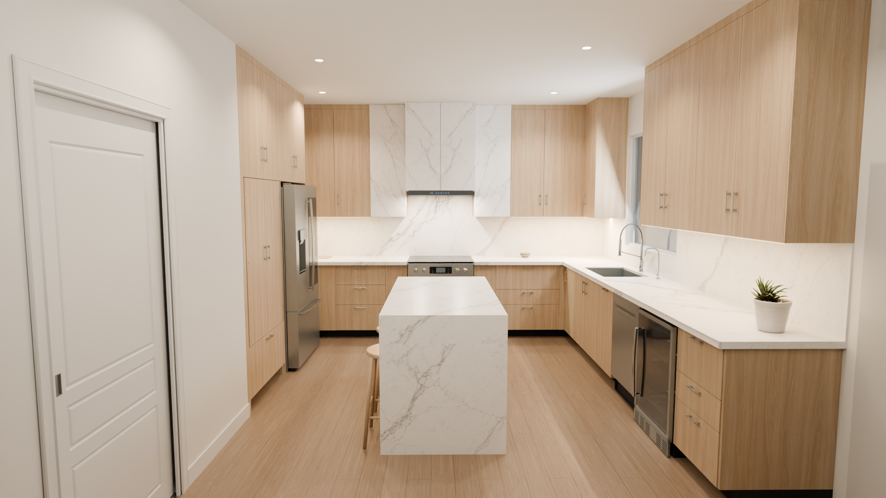
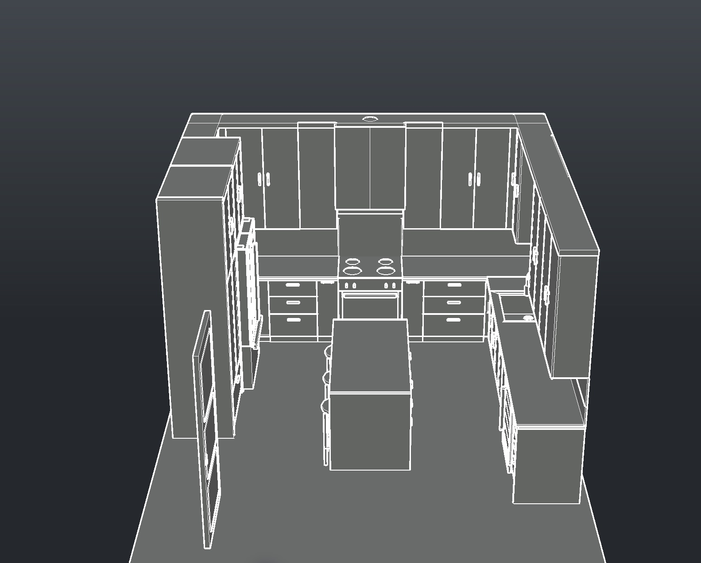
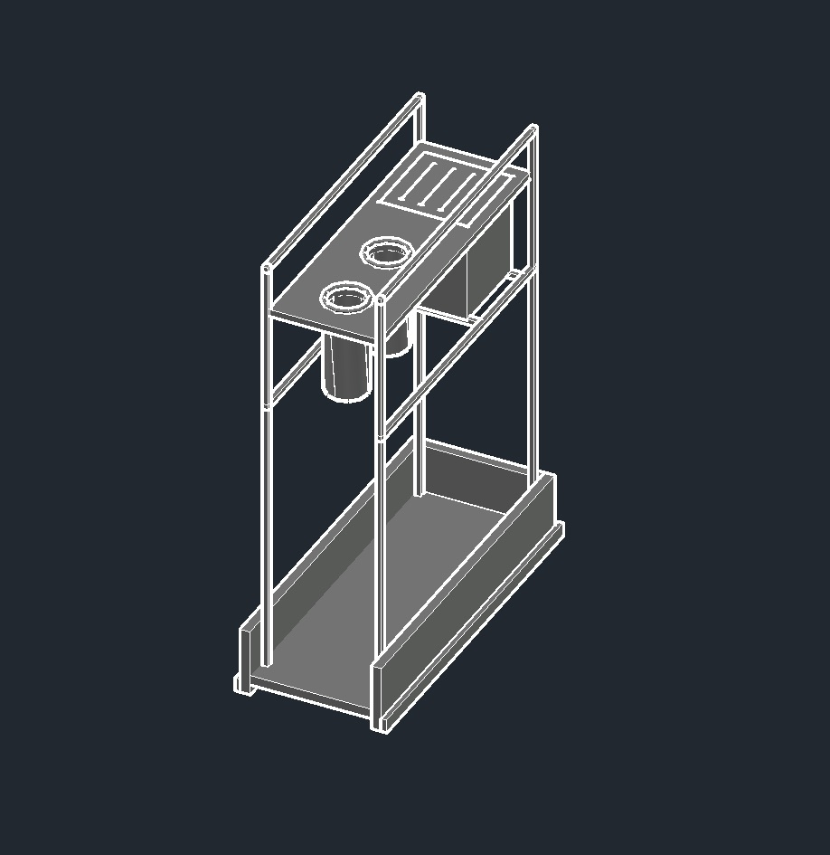

# Kitchen Renovation Modeling

I built a kitchen renovation model because I needed a clearer way to compare the layout, clearances and lighting during a residential renovation. I keep the cabinets, retained appliances, stonework and lighting in one editable visual reference.

I also added a Python study tool because I wanted to understand the services and wall layers behind the model. It compares electrical loads and lighting, room heating and cooling, pipe and duct sizes, wall heat and moisture, and building clashes. These calculations use clearly labeled synthetic examples, including a two-storey coordination model. They are learning studies, not measurements or construction instructions for the actual house.

To try the calculations, use Python 3.12 or newer from the repository root:

```sh
python3.12 -m venv .venv
source .venv/bin/activate
python -m pip install -e '.[test]'
python -m renovation --output output
open output/index.html  # macOS; on other systems open this file in a browser
```

The report links to readable calculation pages, warning lists, editable drawings and a building model. No server or paid CAD application is needed to calculate the examples. To view the kitchen itself, start with the walkthrough below or open the [Blender model](Blender/Kitchen_Renovation.blend).

## Walkthrough

My walkthrough follows the kitchen at eye level, demonstrates selected appliance and drawer clearances, and closes with a comparison of the lighting systems.

https://github.com/user-attachments/assets/2e3ea079-7554-4750-bff1-a47eb61ab4c0

[Download the full-resolution video](Media/Kitchen_Walkthrough.mp4)

## Design and coordination



I combined vertically grained white oak cabinetry, white porcelain doors and cladding, and a quartz island. The retained refrigerator, electric range and Sakura hood are integrated into the cabinet and stone layout. The model includes individual cabinet fronts, supported pullout mechanisms, appliance interiors, built-up stone edges, lighting and a single outward-facing island waterfall.

In this revision I coordinated the selected B hood arrangement, the separate backsplash extending below the countertop, an inside-left pocket-door pull, a spice pullout to the left of the range, a utensil pullout to the right, and a tandem garbage/recycling pullout.



*Native AutoCAD model, with contextual walls and ceiling hidden for inspection.*



*Editable organizer components and supports. Cutaway visibility is for inspection only.*

## Project files

| File | Purpose |
| --- | --- |
| [Blender model](Blender/Kitchen_Renovation.blend) | Editable scene with packed textures, materials, lighting, cameras and mechanisms. |
| [Blender scripts and inspection views](Blender/Support.zip) | Portable rendering and fit-check scripts, plus generated mechanism views. See the [Blender instructions](Blender/README.md). |
| [AutoCAD 3D model](AutoCAD/Drawings/Kitchen_3D.dwg) | Native solids and named assemblies for dimensional coordination. |
| [AutoCAD drawing file](AutoCAD/Drawings/Kitchen_Documentation.dwg) | Editable documentation, dimensions and nine sheet layouts. |
| [Generated AutoCAD drawing set](AutoCAD/Kitchen_Coordination_Set.pdf) | Plans, elevations, island details, pullouts, pocket door and stone junctions. |
| [AutoCAD rebuild scripts](AutoCAD/Rebuild/) | Native AutoLISP authoring snapshots. See the [CAD instructions](AutoCAD/README.txt) before use. |
| [Verification record](AutoCAD/Verification.json) | Recorded native geometry, dimension, drawing and export checks. |

## What the study reports show

| Report | What I can compare |
| --- | --- |
| Electrical and lighting | Everything plugged in versus an assigned simultaneous demand; wire sizes, voltage lost along each cable, fault current, breaker warnings and light reaching a room grid. |
| Heating, cooling and water | Heat through the enclosure and moving air, internal gains, circular air-duct sizes and water-pipe sizes from a bounded fixture table. |
| Wall layers | Resistance to heat flow, temperature through a wall, four declared control functions and moisture that could condense between layers. |
| Building coordination | Two storeys with separate architecture and services, equipment schedules, collisions, disconnected connections, and crane/hoist access checks. |
| Calculation pages | Equations, substituted numbers and physical units for cable sizing, voltage drop, transformer loading and short-circuit current. |

A connected load is the sum of the equipment ratings. A demand load uses a factor I explicitly assign to represent simultaneous operation; the program does not choose a code allowance for me. A short circuit is an unintended low-resistance path, and its estimated current is compared with a breaker's stated interrupting capacity. Branch sizing always checks connected load, so reducing assigned demand cannot hide an overloaded branch. The tool flags overload, undersized wires, excessive voltage loss and unsupported inputs.

For the wall, I add each layer's thickness divided by its conductivity to get RSI, a measure of resistance to heat flow. I then find the temperature and water-vapour pressure between layers. Where the vapour reaches saturation, the steady-state Glaser calculation estimates a condensation rate and checks the incoming/outgoing moisture balance. Air, water, vapour and thermal continuity are declared input properties; this tool cannot inspect real seams or workmanship.

The building model uses IFC, an open format for building geometry and equipment data, generated with IfcOpenShell. I can reopen it in FreeCAD or another IFC viewer. Its separate discipline models let me find a duct crossing a wall without an opening, distinguish that from a valid opening, list equipment properties, and check connections. The accompanying DXF files are editable CAD drawings. This follows the model, schedule and coordination workflow I wanted to learn from tools such as Revit and Revizto, within a small rectangular-geometry study.

## Change an example

I edit a copy of `examples/` and keep the unit labels. For example, a longer cable changes the voltage drop, moving an opening changes a clash, and adding exterior insulation changes wall interface temperatures.

```sh
cp -R examples my-study
python -m renovation --input my-study --output output
python -m pytest -q
python scripts/execute_notebooks.py --output output/notebooks
```

The [electrical notes](docs/electrical.md), [mechanical notes](docs/mechanical.md), [wall notes](docs/envelope-screen.md), [BIM notes](docs/bim.md) and [calculation-sheet notes](docs/calculation-sheets.md) walk through inputs, equations, source tables and worked checks. The two [notebooks](notebooks/) expose the symbolic equations and unit-checked results. Each module can also run independently through its documented Python API.

## Assumptions I keep visible

I use published US reference tables as bounded teaching inputs, not an automatic interpretation of Ontario electrical or plumbing rules. Demand factors, material properties, climate and luminaire intensity curves are declared study assumptions. The mechanical model is a steady heat balance, with prescribed solar gains and humidity values; it does not perform an hourly whole-building simulation. The wall model omits rain, air leakage, annual drying and thermal bridges.

Clash detection is exact for the generated axis-aligned rectangular solids and their rectangular openings. It is not a general collision engine for arbitrary imported geometry. Crane checks compare plan distances with a swing radius, without load charts, lifting capacity or moving collision analysis. The CSV/HTML issues are BCF-style review lists with element IDs and locations, not a full BCF exchange archive. Every output is preliminary and needs qualified review before any real installation decision.

## Working with the models

I organized the Blender scene into editable collections and packed seven image assets. The walkthrough uses Cycles with Metal acceleration at 1920 × 1080, 24 fps. Open the scene in Blender 5.2.2 LTS or a compatible later version.

The AutoCAD files contain 947 native solids in 89 assemblies, 99 dimension entities and nine 24 × 18-inch layouts. Drawing units are inches. From the living room looking toward the range, the refrigerator and garage-side door are on the left and the window is on the right. The 3D model and documentation are separate files and should be revised together.

Large binary files use Git LFS. To obtain editable files through Git:

```sh
git lfs install
git clone https://github.com/jackaI1/Kitchen-Renovation-Modeling.git
cd Kitchen-Renovation-Modeling
git lfs pull
```

## Sheets for the contractor

I built a sheet kit that turns my kitchen drawing details into print-ready sheets and cleaned site photos, because my drawings and photos go to contractors in several formats, and I wanted every version to come from one source. The sheet is an editable Inkscape file, a free drawing program. It holds the title block, the sheet list, the revision table, the finish schedule and the notes. The site photos go through GIMP, a free photo editor, so they are the same size and tone on the sheet.

The layout and the wording live in two places. The layout is a single SVG file that I can open in Inkscape and move boxes around. The text is in `sheet_kit/data/kitchen.json`. One command reads both and writes three files: a 24 by 18 inch PDF to print at full size, an 11 by 8.25 inch PDF for the contractor, and a PNG for sharing. Before it writes anything, it measures every line of text against its box. If a line would be cut off, the build stops and names the box, so a clipped sheet never goes out.

To make the sheets, run these from the repository root:

```sh
python -m pip install -r sheet_kit/requirements.txt
python -m sheet_kit --output output/sheet-kit
```

Site photos stay out of the repository. Put them in a folder outside it, named after the photo IDs in `kitchen.json`, and add `--photos your-folder --gimp /path/to/gimp` to clean them with GIMP first. Without photos, the frames are left empty and the captions say "photo to add".

Technically, the build is a small Python package in `sheet_kit/`. It uses svglib to convert the SVG to a PDF with reportlab, and pypdfium2 to render the PNG from that PDF, so the three files always match. The GIMP cleanup is a Script-Fu script that crops each photo to its frame's shape, stretches the levels, sharpens lightly and scales it to a fixed width. Tests check the page sizes, the PNG size, that every text box fits, that the same input gives the same bytes, and that a photo with the wrong shape is refused. GitHub Actions installs Inkscape and GIMP on Ubuntu, runs the tests, builds the sheets with cleaned photos and checks the output sizes. Design notes are in [docs/sheet-kit.md](docs/sheet-kit.md).

## Use and verification

This package supports onsite discussion, layout review and design decisions. It is a coordination study, not a fabrication release. Confirm the actual Sakura hood, final stone templates, selected hardware and relevant field dimensions before ordering or construction. Proposed organizers and bin layouts illustrate the intended arrangement; final supplier specifications and load ratings remain to be confirmed.

I checked the models numerically, with targeted mechanism travel checks and native AutoCAD drawing audits. I also inspected rendered views and exported drawing sheets. Unverified product selections and field dimensions remain coordination assumptions.

This repository contains project outputs only. The supplied reference photos, architectural attachments, email material and property address are excluded. AutoCAD files were authored using an education license; licensing provenance and native-file metadata are documented in the [CAD package notes](AutoCAD/README.txt).

## Calculation design and verification

I separated the calculation modules so I can follow one method at a time. JSON inputs name their SI units, and validation rejects unsupported units, non-finite values and out-of-range table requests. The electrical study sums transformer and cable impedances as complex resistance plus reactance. The lighting study interpolates tabulated candela values, then applies inverse-square and cosine laws at each point. The mechanical study uses heat balances and Darcy-Weisbach friction, and the wall study solves saturated condensation planes with a diffusion mass balance. The [design notes](docs/design.md) describe these boundaries.

The calculation sheets use SymPy to keep the equation visible and pint to carry the units through the arithmetic. I compare the symbolic SI substitution with the dimension-checked value before export. Tests cover hand calculations, bad inputs, seeded collisions, opening false positives, actual IFC reopening and DXF entities. GitHub Actions runs the full tests, regenerates all five study reports, executes both notebooks and uploads the models, drawings and reports as a downloadable artifact on every change. Existing Blender and AutoCAD deliverables remain available above.

The current suite has 127 passing tests, including the three original wall checks and ten sheet-kit checks. A GIMP batch test for the sheet kit runs only in its own workflow, where GIMP is installed. The deterministic example produces three panels, six circuits, a 20-point lighting grid, three wall studies and 34 IFC elements with 19 intentionally seeded review issues. Both calculation notebooks execute in CI; the runner records and verifies cleanup of each temporary kernel.


## Other things I've built here

- [cpm-schedule-xer](projects/cpm-schedule-xer/)
- [project-schedule-cost-tracker](projects/project-schedule-cost-tracker/)
- [vessel-3d-viewer](projects/vessel-3d-viewer/)
