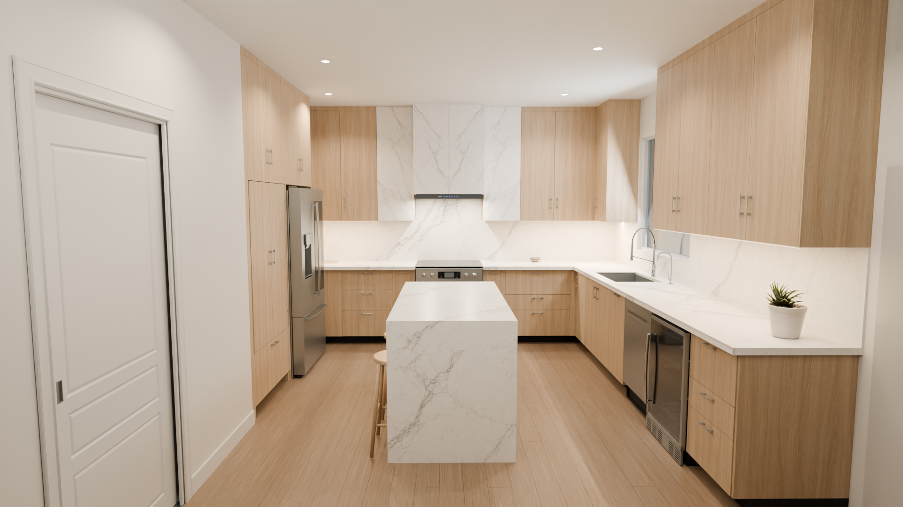
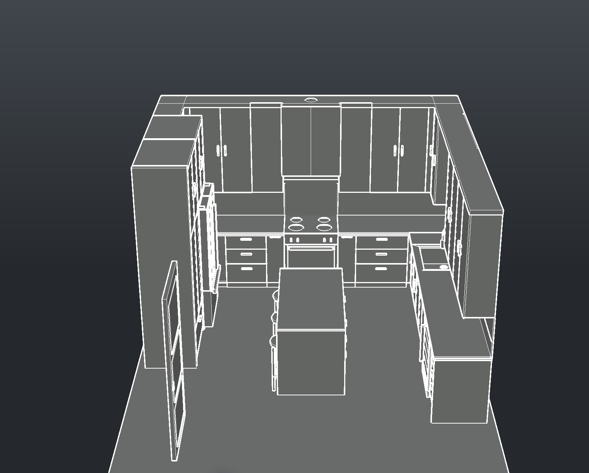
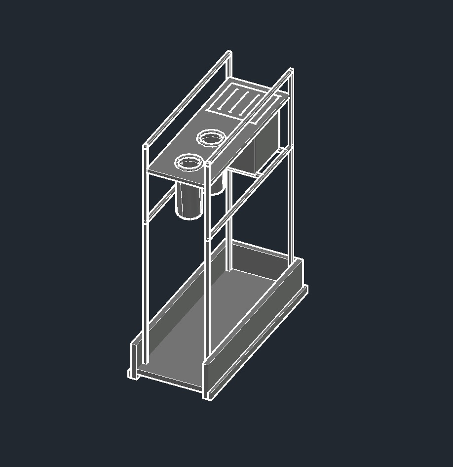

# Kitchen Renovation Modeling

A coordinated Blender and AutoCAD study developed for **onsite reference and design decisions** during a residential kitchen renovation. The project brings the cabinet layout, retained appliances, stonework, hardware and lighting into one editable visual and dimensional reference.

## Walkthrough

The walkthrough follows the kitchen at eye level, demonstrates selected appliance and drawer clearances, and closes with a comparison of the lighting systems.

https://github.com/user-attachments/assets/a2729eac-e0e3-4c1c-964b-a7cd38fbd0dc

[Download the full-resolution video](Media/Kitchen_Walkthrough_Previous.mp4)

**Video revision:** this is the last completed selected-B walkthrough. It predates the October 22 pocket-door and pullout refinements. The editable models, drawings and still image below contain those refinements; the replacement render is in progress.

## Design and coordination



The design combines vertically grained white oak cabinetry, white porcelain doors and cladding, and a quartz island. The retained refrigerator, electric range and Sakura hood are integrated into the cabinet and stone layout. The model includes individual cabinet fronts, supported pullout mechanisms, appliance interiors, built-up stone edges, lighting and a single outward-facing island waterfall.

The current revision coordinates the selected B hood arrangement, the separate backsplash extending below the countertop, an inside-left pocket-door pull, a spice pullout to the left of the range, a utensil pullout to the right, and a tandem garbage/recycling pullout.



*Native AutoCAD model, with contextual walls and ceiling hidden for inspection.*



*Editable organizer components and supports. Cutaway visibility is for inspection only.*

## Project files

| File | Purpose |
| --- | --- |
| [Blender model](Blender/Kitchen_Renovation.blend) | Editable scene with packed textures, materials, lighting, cameras and mechanisms. |
| [AutoCAD 3D model](AutoCAD/Drawings/Kitchen_3D.dwg) | Native solids and named assemblies for dimensional coordination. |
| [AutoCAD drawing file](AutoCAD/Drawings/Kitchen_Documentation.dwg) | Editable documentation, dimensions and nine sheet layouts. |
| [Generated AutoCAD drawing set](AutoCAD/Kitchen_Coordination_Set.pdf) | Plans, elevations, island details, pullouts, pocket door and stone junctions. |
| [AutoCAD rebuild scripts](AutoCAD/Rebuild/) | Native AutoLISP authoring snapshots. See the [CAD instructions](AutoCAD/README.txt) before use. |
| [Verification record](AutoCAD/Verification.json) | Recorded native geometry, dimension, drawing and export checks. |

## Working with the models

The Blender scene is organized into editable collections and contains seven packed image assets. The walkthrough uses Cycles with Metal acceleration at 1920 × 1080, 24 fps. Open the scene in Blender 5.2.2 LTS or a compatible later version.

The AutoCAD files contain 947 native solids in 89 assemblies, 99 dimension entities and nine 24 × 18-inch layouts. Drawing units are inches. From the living room looking toward the range, the refrigerator and garage-side door are on the left and the window is on the right. The 3D model and documentation are separate files and should be revised together.

Large binary files use Git LFS. To obtain editable files through Git:

```sh
git lfs install
git clone https://github.com/jackaI1/Kitchen-Renovation-Modeling.git
cd Kitchen-Renovation-Modeling
git lfs pull
```

## Use and verification

This package supports onsite discussion, layout review and design decisions. It is a coordination study, not a fabrication release. Confirm the actual Sakura hood, final stone templates, selected hardware and relevant field dimensions before ordering or construction. Proposed organizers and bin layouts illustrate the intended arrangement; final supplier specifications and load ratings remain to be confirmed.

The models were checked numerically, with targeted mechanism travel checks and native AutoCAD drawing audits. Rendered views and exported drawing sheets were also inspected. Unverified product selections and field dimensions remain coordination assumptions.

This repository contains project outputs only. The supplied reference photos, architectural attachments, email material and property address are excluded. AutoCAD files were authored using an education license; licensing provenance and native-file metadata are documented in the [CAD package notes](AutoCAD/README.txt).
