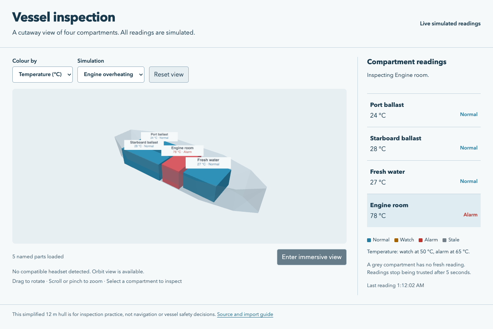

# vessel-3d-viewer

I built a browser-based vessel viewer to learn how the underlying idea works. This is a learning project.

## Try it

Install [Node.js](https://nodejs.org/) 22.12 or newer, then run:

```sh
npm ci
npm run dev
```

Open **http://127.0.0.1:5173**. The one command starts the viewer and its simulated sensor server. Drag the vessel to rotate it, scroll or pinch to zoom, and click a compartment or its reading in the list. Choose **Port tank high level** or **Engine overheating** under Simulation to see an alarm. Use **Reset view** to return to the starting angle. Stop the server with Ctrl+C.



I use blue for normal readings, amber for a watch condition, red for an alarm, and grey for stale data. Every colour also has a written status. Tank level changes to watch at 75% and alarm at 90%; temperature changes at 50 °C and 65 °C. These are demonstration thresholds, not marine operating limits. All readings, including the engine-room level, are synthetic examples.

## View it in a headset

On a browser and headset that support WebXR, the browser interface for immersive 3D, **Enter immersive view** opens a tabletop-sized vessel with the same live colours and labels. Point a controller and select a compartment to inspect it; the list selection is retained after leaving the headset. Leaving the session restores the orbit view. Browsers without a compatible headset keep the normal mouse and touch view.

## How I bring in the model

I keep the original dimensions in [data/source/vessel.json](data/source/vessel.json), with distances in metres and a permanent name for each compartment. My [Python script](pipeline/export_vessel.py) runs inside Blender, builds an open hull and compartments, applies transforms, merges coincident vertices, removes loose geometry, recalculates normals, and triangulates the meshes. It exports glTF, a compact format for moving 3D scenes between tools, as one `.glb` file.

The exported model is committed, so Blender is only needed to change it:

```sh
# Install Blender 4.2 or newer and make its blender command available.
npm run model:build
npm run model:validate
```

On macOS, if Blender is not on PATH:

The [import guide](docs/import-pipeline.md) covers storing source files, processing them, validating the export, importing it into the viewer, and changing a compartment without breaking its sensor mapping. My simplified 12 m hull is original geometry, not a scan or a seaworthiness model.

## How the live view works

The TypeScript server sends JSON readings over WebSocket, a connection that keeps sending updates without reloading the page. Each browser has its own simulation scenario. The viewer uses three.js to draw the glTF scene, matches readings to exact mesh names, and draws labels in the 3D scene so they also appear in immersive view.

I reject incomplete packets, unknown or duplicate compartment names, non-finite numbers, readings outside the accepted ranges, future timestamps, and readings older than five seconds. Sequence numbers prevent older packets from replacing newer ones. A dropped connection greys the readings and retries every 1.5 seconds. A new connection resets the sequence counter. The model is checked for missing names, duplicate names, invalid vertices, and an excessive triangle count before it is shown.

For a built version:

```sh
npm run build
npm start
```

This serves `dist/` and the sensor stream on the same port. `PORT=5180 npm start` chooses another port. The default bind address is localhost. `HOST=0.0.0.0 npm start` allows LAN access; use HTTPS through a reverse proxy for a headset. This simulator has no authentication and is intended for local use, not public control of real equipment.

## Tests and limits

There are 7 test source files in this copy. No test pass count is claimed here: I have not re-run the project suite as part of this move. This is a source snapshot, and running it on a new machine may need environment-specific setup.


The relocated workflow did not complete successfully within the migration batch. Local test sources remain available.

I did not retain a project-specific GitHub Actions workflow. The test sources remain in this folder for local use.
